# Awesome AI Customer Service Automation 🎧 🤖

  

  
  
  
  
  
  

---

## 🌟 Top AI Customer Service Automation Ecosystem

**Curated List of Commercial AI Support Platforms & Open-Source Customer Service Frameworks**  
*Focused on Autonomous Resolution, Agentic AI Support, Omnichannel Helpdesks, Ticket Deflection, Copilots, and Self-Hosted LLM Solutions.*

**Last updated: October 2026** 📅

---

### 📌 Overview & SEO Summary

Welcome to the definitive directory of **AI customer service automation platforms**, **agentic customer support systems**, **open-source helpdesk software**, and **conversational AI chatbots**. 

Whether you are evaluating enterprise commercial platforms (*Salesforce Agentforce / Service AI*, *Intercom Fin*, *Sierra AI*, *Decagon*, *Zendesk AI*, *Parloa*) or self-hosting open-source alternatives (*n8n*, *Dify*, *Flowise*, *Chatwoot*, *LiveKit*, *Rasa*, *Zammad*, *FreeScout*, *Klio Customer Support Agent*), this repository provides verified pricing starting tiers, free trial allowances, company valuation benchmarks, and star rankings.

#### 🎯 Key Technologies & Topics Covered:
- **Agentic Customer Support & Autonomous Resolution**: Multi-step reasoning AI agents capable of resolving tier-1 and tier-2 tickets end-to-end.
- **Outcome-Based vs. Consumption Pricing**: Detailed cost structures ($/resolution vs $/month vs usage credits).
- **Omnichannel Live Chat & Shared Inboxes**: Unified support queues across Web, WhatsApp, Email, Slack, and SMS.
- **Retrieval-Augmented Generation (RAG) for Support**: Knowledge base indexing with vector databases (pgvector, Qdrant, Pinecone) for accurate semantic search.
- **Enterprise Contact Center AI (CCaaS)**: Real-time voice agents, WebRTC streaming, and call center co-pilots.

**Key Market Context:**

- **ISG's 2026 AI Self-Service Buyers Guide** ranked **NiCE, Verint, and Salesforce as overall Leaders**, with **Content Guru, Dialpad, Five9, Genesys, Microsoft, RingCentral, Salesforce, Sprinklr, Talkdesk, Verint, Zendesk, and Zoom rated Exemplary** .

- **Salesforce's Help Worker Solution** uses **purely outcome-based pricing** — **400 Flex Credits per resolution**, charged only when the worker successfully resolves a query or request (not discarded sessions, negative feedback, or pre-feedback escalations) .

- **Intercom Fin** charges **$0.99 per outcome** with **no seat costs, no setup fees, and no platform fees** — an outcome is counted when a customer confirms resolution, doesn't ask for more help, or Fin completes a workflow .

- **Sierra AI** publishes **no pricing page, no rate card, and no per-outcome rate** — every commercial term including the definition of "resolved" is negotiated directly .

- **Decagon** requires a **$50,000/year platform fee** before any usage costs, with **per-conversation or per-resolution pricing** estimated at **~$0.99 per conversation** .

- **Parloa** uses **consumption-based pricing** — **per minute for voice and per interaction for chat**, with rates reflecting the complexity of each use case .

- **Ada CX** starts at **$33,000/year for 60,000 conversations** (AWS Marketplace), with implementation expenses ranging from **$15,000 to $100,000+** .

- **Forethought** blends **platform access fees with outcome-based pricing**, with implementation costs of **$10,000–$50,000+** and annual price escalators of **3–7%** .

- **Freshservice Freddy AI** offers **500 free AI sessions** with Growth, Pro, and Enterprise plans, then charges **$49 per 100 sessions** — a session is a **24-hour window** for chat or a **72-hour window** for email .

- **Klio Customer Support Agent** is the **most complete open-source AI support agent with an embeddable chat widget** — knowledge base with URL crawling and document upload, pgvector semantic search, configurable escalation rules, and webhooks for escalation, completion, and low-confidence events .

---

## 📑 Table of Contents

- [🏢 SaaS & Commercial Platforms](#-saas--commercial-platforms)

- [🔓 Open-Source GitHub Projects](#-open-source-github-projects)

- [🛠️ How to Contribute](#%EF%B8%8F-how-to-contribute)

- [📊 Star History](#-star-history)

- [🤝 Support & Sponsorship](#-support--sponsorship)

- [⚠️ Disclaimer](#%EF%B8%8F-disclaimer)

---

## 🏢 SaaS & Commercial Platforms

> **Market Size & Structure Analysis (2026):** The global AI customer service and support automation market is estimated at **$15.1B–$19.5B in 2026** (projected to reach $47B–$83B by 2030–2033 at a 23–26% CAGR). The sector exhibits a **moderately fragmented yet converging structure**: while hyperscale CRM giants (Salesforce, Zendesk, Microsoft) are consolidating core helpdesk ecosystems via platform-native AI agents, the market remains fragmented across specialized high-growth AI-native startups and vertical voice/multimodal CX specialists that capture substantial enterprise market share.

| SaaS / Commercial Platform | Company / Owner | Valuation / Revenue | Standard Edition Starting Price | Free Tier / Free Trial Limits | Description |
| :--- | :--- | :--- | :--- | :--- | :--- |
| **[Salesforce Service AI](https://www.salesforce.com/service/)** ☁️ | Salesforce | ~$250B Market Cap | **$25/user/month** (Starter Suite) or **400 Flex Credits ($2/conversation)** for Help Worker / Agentforce | **30-day free trial** (pre-configured Service Cloud environment, no credit card required) | **CRM-native autonomous service** — Help Worker Solution uses outcome-based pricing: 400 Flex Credits only when the worker successfully resolves a query. Agentforce Voice minutes billed per full minute. Enhanced Chat: max 2-hour interaction. Voice: max 10-minute resolution. ISG 2026 AI Self-Service Leader. |
| **[Sierra AI](https://sierra.ai/)** 🏔️ | Sierra | ~$15.8B Valuation | **$150,000/year minimum platform contract** (~$1.00–$2.50 per resolved interaction) | **No free tier or trial** (sales-led enterprise discovery and custom pilot only) | **Enterprise conversational AI** — Founded by Bret Taylor. Charges per resolved interaction. Sierra publishes no public rate card; definition of "resolved" is negotiated per contract. Implementation: 3–7 months ($50K–$200K). Requires separate helpdesk platform. |
| **[Zendesk AI](https://www.zendesk.com/)** 🟢 | Zendesk | ~$10B Valuation | **$19/agent/month** (Support Team) or **$55/agent/month** (Suite Team with AI agents) | **14-day free trial** (full access to Zendesk Suite features, no credit card required) | **AI-powered customer service** — Suite plans include foundation AI agents. Advanced AI Copilot and Workforce Engagement add-ons at $50/agent/month each. Employee Service AI available at $0.99/additional auto-resolution. |
| **[Decagon](https://decagon.ai/)** 🔷 | Decagon | ~$4.5B Valuation | **$50,000/year platform fee** + **~$0.99/conversation** (or per-resolution) | **No free tier or trial** (enterprise sales demo and scoped pilot only) | **Enterprise AI support concierge** — Per-conversation or per-resolution pricing with customizable AI agents handling refunds, account changes, and multi-step workflows. Requires existing helpdesk (Zendesk, Salesforce). |
| **[Intercom Fin](https://www.intercom.com/)** 💬 | Intercom / Salesforce | ~$3.6B Valuation | **$29/seat/month** (Essential) + **$0.99 per Fin resolution** | **14-day free trial** (includes shared inbox, ticketing, and Fin AI Agent access, no credit card required) | **AI-first customer service platform** — Outcome-based pricing: charged $0.99 only when customer confirms resolution, doesn't ask for more help, or Fin completes a Procedure. Can be used standalone or integrated into external helpdesks. |
| **[Parloa](https://www.parloa.com/)** 🎯 | Parloa | ~$3.0B Valuation | **~$300,000/year enterprise commitment** (consumption-based: per minute voice / per interaction chat) | **No free tier or trial** (enterprise consultative demo and architecture review only) | **Enterprise contact-center AI** — Voice and chat automation with consumption-based billing. Dynamic rate scaling where costs automatically drop as agents become more efficient. Built for high-volume enterprise call centers. |
| **[Freshservice Freddy AI](https://www.freshworks.com/freshdesk/)** 🔵 | Freshworks | ~$3.0B Market Cap | **$19/agent/month** (Freshdesk Growth) + **$49 per 100 Freddy AI sessions** after 500 free sessions | **14-day free trial** (full access to Enterprise plan features) / **Free plan for up to 2 agents (6 months)** with 500 one-time AI sessions | **AI-powered helpdesk & IT service management** — Session defined as 24-hour window (chat) or 72-hour window (email). Freddy AI Agent Studio for omnichannel routing and auto-triage across chat and email. |
| **[Cresta](https://cresta.com/)** 🏢 | Cresta | ~$1.6B Valuation | **$150,000/year** (AWS Marketplace contract: covers up to 125,000 chat interactions or 100,000 voice calls) | **No self-serve free trial** (guided enterprise proof-of-concept only) | **Enterprise generative AI contact center** — Real-time agent assistance, call summarization, objection handling, and conversation intelligence. Rated as provider of Merit in ISG's 2026 AI Self-Service Buyers Guide. |
| **[Ada](https://www.ada.cx/)** 🟢 | Ada | ~$1.2B Valuation | **$33,000/year for 60,000 conversations** (AWS Marketplace) | **No self-serve free trial** (custom enterprise demo and qualification consultation only) | **Enterprise CX automation** — Resolution-focused AI agent handling omni-channel messaging across web, mobile, SMS, and WhatsApp. Implementation ranges from $15,000 to $100,000+. |
| **[Forethought](https://forethought.ai/)** 🧠 | Forethought | ~$400M–$500M Est. Valuation | **~$35,000/year starting contract** (Solve + Triage platform fee + outcome fees) | **No self-serve free trial** (guided Proof of Value / POV assessment only) | **Agentic AI customer support** — Solve, Assist, Triage, and Voice products. Blends base platform fee with deflection-based outcomes. Implementation typically $10,000–$50,000. Named to Forbes Next Billion-Dollar Startups. |

---

## 🔓 Open-Source GitHub Projects

*Sorted by GitHub_Stars_Count (Descending)* 🌟

- **[n8n](https://github.com/n8n-io/n8n)**   
  **Workflow automation with AI capabilities**, Sustainable Use License. **207K+ GitHub stars** — **the most popular open-source workflow automation platform** . **AI Workflow Builder with natural language prompts** . **400+ integrations** . **Self-hosted with unlimited executions** . **Serves as the vital "action execution layer" for AI customer service agents** . 🔄

- **[Dify](https://github.com/langgenius/dify)**   
  **LLMOps platform with agentic workflows**, Apache-2.0 licensed. **158K+ GitHub stars** — **visual drag-and-drop workflow and AI agent builder** . **Built-in RAG pipelines, prompt orchestration, and autonomous agent nodes** . **100+ LLM providers supported** . **Self-hosted or cloud-managed deployment** . **The premier open-source application builder for automated customer support** . 🎨

- **[Flowise](https://github.com/FlowiseAI/Flowise)**   
  **Open-source low-code UI for building customized LLM flows and agents**, Apache-2.0 licensed. **55K+ GitHub stars** — **drag-and-drop orchestration for LangChain and LlamaIndex** . **Easily embed support chatbots, RAG document-search agents, and customer assistant bots with one-click embeddable JavaScript widgets** . 🧩

- **[Chatwoot](https://github.com/chatwoot/chatwoot)**   
  **Open-source customer engagement suite**, MIT licensed. **37K+ GitHub stars** — **the most widely deployed open-source customer support desk** . **Omnichannel inbox: website live chat, email, WhatsApp, Facebook, Instagram, SMS, and Telegram** . **Custom bot integrations, webhooks, and automation triggers** . **Self-hosted for complete data privacy** . 💬

- **[LiveKit](https://github.com/livekit/livekit)**   
  **Real-time voice and video infrastructure for AI agents**, Apache-2.0 licensed. **21K+ GitHub stars** — **high-performance WebRTC platform powering ultra-low-latency real-time voice assistants and conversational AI agents for contact centers** . **Full support for OpenAI Realtime API and Gemini Multimodal Live API** . 🎙️

- **[Rasa](https://github.com/RasaHQ/rasa)**   
  **Conversational AI framework for enterprise customer care**, Apache-2.0 licensed (core). **21K+ GitHub stars** — **enterprise-grade on-premises conversational AI** . **CALM (Conversational AI with Language Models) architecture combines LLMs with deterministic enterprise business logic** . **Complete data sovereignty** . 🏛️

- **[Botpress](https://github.com/botpress/botpress)**   
  **Open-source chatbot building platform**, AGPL-3.0 licensed. **14K+ GitHub stars** — **visual conversation flow builder with native NLU** . **Multi-channel deployment across web widget, WhatsApp, Slack, and Telegram** . 🤖

- **[Papercups](https://github.com/papercups-io/papercups)**   
  **Open-source live customer chat widget and messaging platform**, MIT licensed. **6.1K+ GitHub stars** — **built in Elixir and React, offering lightweight customer chat widgets, Slack sync, email forwarding, and clean API endpoints for automated bot integrations** . 💬

- **[Zammad](https://github.com/zammad/zammad)**   
  **Open-source helpdesk and customer support ticketing system**, AGPL-3.0 licensed. **6.0K+ GitHub stars** — **feature-rich helpdesk system with multi-channel ticket management, knowledge base, SLA tracking, and REST APIs for automated ticket triage** . 🎫

- **[FreeScout](https://github.com/freescout-helpdesk/freescout)**   
  **Open-source shared inbox and help desk**, AGPL-3.0 licensed. **4.6K+ GitHub stars** — **lightweight, self-hosted Zendesk & Help Scout alternative built with PHP/Laravel** . **Community modules for AI summaries, auto-replies, and WhatsApp integration** . 📬

- **[Zaturn](https://github.com/kdqed/zaturn)**   
  **AI Co-Pilot for data analytics and business insights**, open-source. **75 GitHub stars** — **natural language interface to database intelligence without SQL or Python** . **Generates charts and visualizations from support database interactions** . 📊

- **[Klio Customer Support Agent](https://github.com/klio-tech/customer_support_agent)**   
  **Turnkey open-source AI customer support agent with embeddable widget**, MIT licensed. **Embeddable chat widget with single script tag** — Shadow DOM isolation, localStorage session persistence, streaming Markdown responses, and identity passthrough . **Knowledge base with sitemap URL crawling and document ingestion (PDF, TXT, CSV, JSON)** with pgvector semantic similarity search . **Configurable `agent.config.yaml` for system prompts, model selection, confidence-based escalation thresholds, and webhook notifications** . 🛠️

- **[OpenCloser](https://github.com/issacops/opencloser)**   
  **Open-source AI SDR & sales automation agent**, MIT licensed. **Autonomous lead qualification, real-time voice agent powered by Gemini, live transcription, objection detection, and post-call analytics** . 🚀

---

## 🛠️ How to Contribute

Contributions are welcome! Follow these steps to submit new AI customer service platforms or open-source support automation software:

1. 🍴 **Fork** the repository.

2. 📝 **Add/edit** entries in `README.md` maintaining table/list structure and formatting.

3. 🔗 Include project title, official website/GitHub link, exact Stars_Count, license, and brief description.

4. 🚀 Submit a **Pull Request** with a descriptive summary of your changes.

---

##  Star History

---

## 🤝 Support & Sponsorship

Thank you so much for visiting and using the **Awesome AI Customer Service Automation** directory! 🙌 

Maintaining an up-to-date, transparent index of enterprise AI platforms, outcome-based pricing models, and open-source customer support software takes continuous research and community feedback. If this resource has helped your team, startup, or enterprise evaluate AI support tooling, please consider supporting the project:

- ⭐ **Star this repository** on GitHub to help others discover it!
- 🔀 **Fork and share** with colleagues, CX leaders, engineering managers, and open-source advocates.
- 📢 **Contribute**: Submit a pull request or suggest new projects to keep the community ahead.
- ☕ **Buy Me a Coffee & Sponsor**: Support ongoing independent open-source curation directly through the [GitHub Sponsor Dashboard](https://github.com/sponsors/ishandutta2007). Every coffee fuels more in-depth reviews and benchmarking!

---

## ⚠️ Disclaimer

- This is a **community-curated** list — not exhaustive and not an endorsement. ℹ️

- **ISG's 2026 AI Self-Service Buyers Guide** ranked **NiCE, Verint, and Salesforce as overall Leaders**, with **Content Guru, Dialpad, Five9, Genesys, Microsoft, RingCentral, Salesforce, Sprinklr, Talkdesk, Verint, Zendesk, and Zoom rated Exemplary** . **Cresta and Sierra were rated as providers of Merit** .

- **Salesforce's Help Worker Solution uses purely outcome-based pricing** — **400 Flex Credits per resolution**, charged only when the worker successfully resolves a query or request . **Salesforce was also rated a Leader in ISG's 2026 AI Self-Service Buyers Guide** .

- **Intercom Fin charges $0.99 per outcome** with **no seat costs, no setup fees, and no platform fees** — and can be used with existing helpdesk (Salesforce, etc.) with **zero Intercom seats** . **Decagon requires a $50,000/year platform fee before any usage costs** . **Sierra AI publishes no pricing at all** . **Ada starts at $33,000/year for 60,000 conversations** .

- **Open-source support automation tools are not turnkey** — **Klio requires PostgreSQL with pgvector, Node.js, and an LLM provider API key** . **Chatwoot and Zammad require deployment and maintenance** . **Dify requires PostgreSQL, Redis, and a vector database** . **Always validate automation accuracy and escalation logic with a proof-of-concept** before production deployment. 🤖

---

  <b>Made with ❤️ for support leaders, CX professionals, and open-source customer service advocates.</b>

